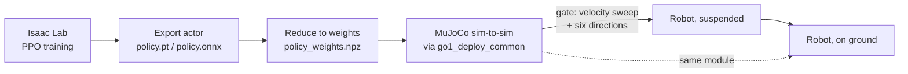
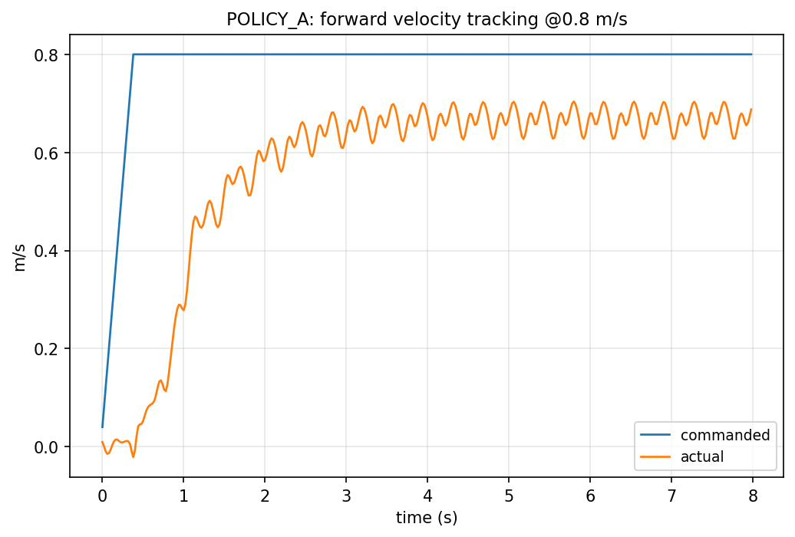
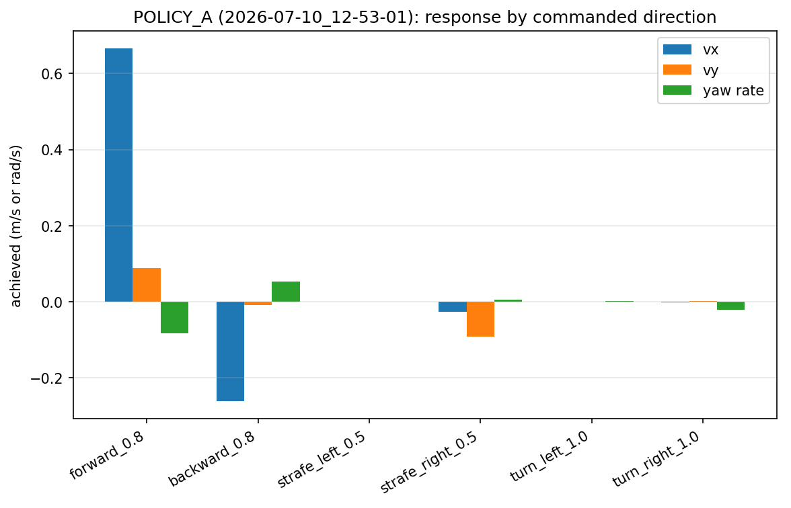
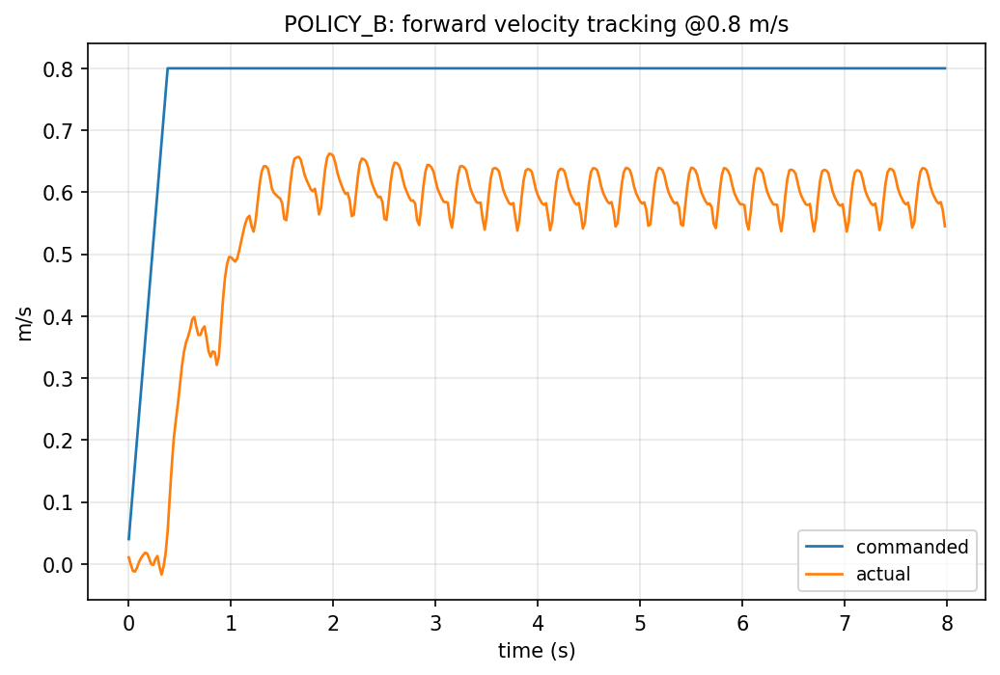
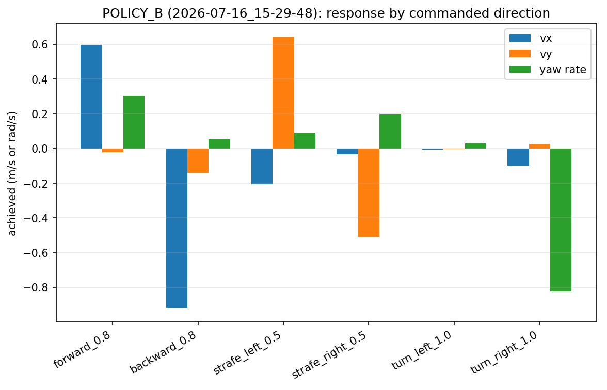
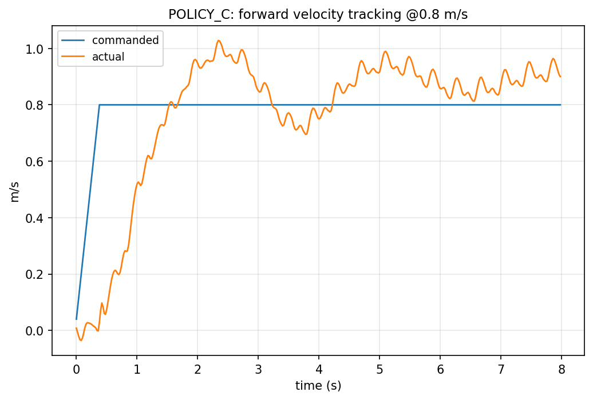
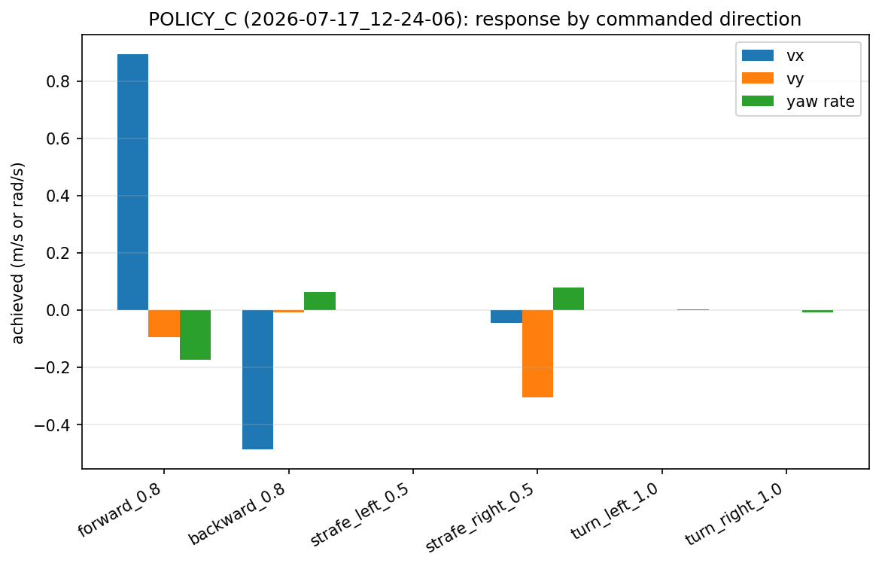
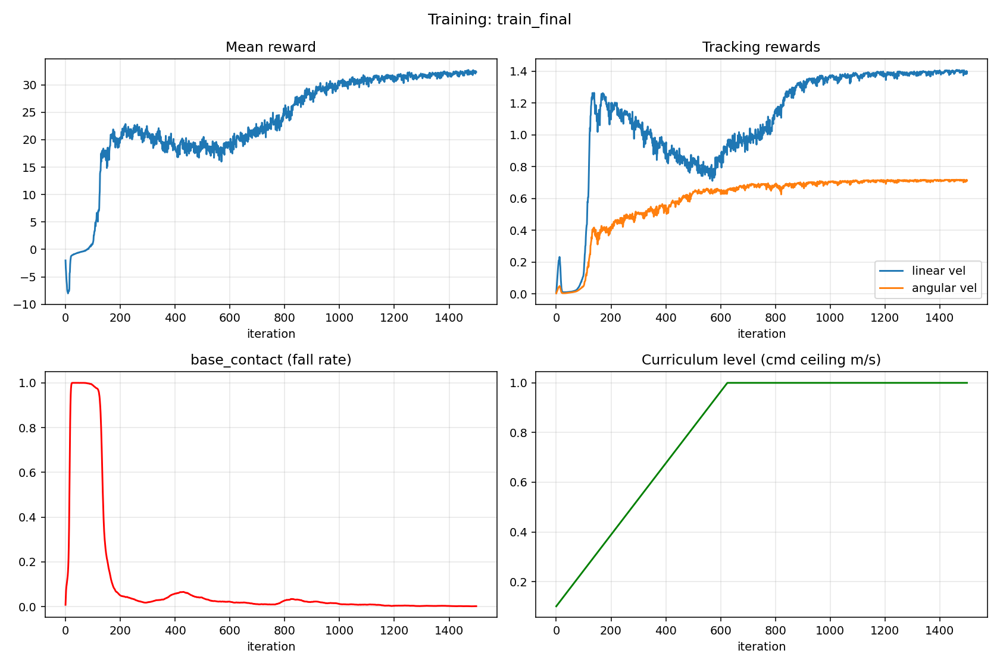

# Go1 Sim-to-Real Walking: Isaac Lab → MuJoCo → Hardware


**▶ [Watch the real-robot video](docs/results/videos/real_robot_walking.mp4)** · [Graphs and all videos](docs/GALLERY.md) · [Full project report](docs/WORKFLOW_REPORT.md) · [Policy table](docs/POLICY_REFERENCE.md)

Sim-to-real transfer of a deep-RL walking controller for the **Unitree Go1** quadruped.
A policy is trained with PPO in **NVIDIA Isaac Lab**, gated through an independent **MuJoCo**
sim-to-sim check, and deployed on the real robot with a **pure-numpy** forward pass
(no PyTorch / ONNX on the robot).

Developed during an M2 EEEA (MMVAI) internship at the IBISC laboratory,
Université d'Évry Paris-Saclay, 2026.

## Highlights

- **Deployable observation (45-D, single frame, no base linear velocity)** — only IMU and joint encoders, because the real Go1 cannot measure its own linear velocity.
- **One shared deployment module** (`go1_deploy_common.py`) used unchanged by both the MuJoCo validation and the real robot — a MuJoCo pass is therefore genuine evidence about the robot, not a parallel reimplementation.
- **Framework-independent inference.** The actor MLP is reduced to plain arrays in an `.npz` and evaluated with numpy, bypassing the robot's Python 3.6 / PyTorch 1.4 stack (where ONNX Runtime couldn't be installed and modern TorchScript exports were unreadable).
- **Verified joint orderings** (Isaac Lab ↔ Unitree raw ↔ Walk-These-Ways), with every permutation asserted to compose with its inverse to the identity.
- **Empirical finding:** the policy with the best Isaac Lab training metrics (Policy C) transferred worst in MuJoCo and was never ground-tested; training-simulator metrics did not predict transfer quality.
- **Verified reproducible end-to-end**: `mujoco_sim2sim/deploy_sim_test.py`, run against the actual exported weights in this repo, reproduces the thesis's reported Policy A sweep exactly (see below).

## Pipeline



## Repository layout

```
.
├── isaaclab/                   # Isaac Lab task: env/reward/curriculum code, train/play scripts
│   └── run_configs/            # exact recorded config for every training run (26), incl. A/B/C
├── mujoco_sim2sim/
│   ├── go1_deploy_common.py    # shared obs / joint maps / numpy MLP — single source of truth
│   ├── deploy_sim_test.py      # forward-speed sweep through the deployment code path
│   ├── deploy_sim_viewer.py    # interactive MuJoCo viewer, same code path
│   ├── mujoco_run.py           # ONNX-based runner (interactive + scripted trajectory logging)
│   └── mujoco_menagerie/unitree_go1/   # Go1 MJCF model (Unitree, BSD-3-Clause)
├── deployment/
│   └── deploy_go1_isaaclab.py  # real-robot runner: LCM I/O, R2 state machine, full safety protocol
├── exported_policies/
│   ├── go1_deploy_proven/      # Policy A — the one actually deployed (.npz, .pt, .onnx)
│   ├── policy_B_5of6/          # Policy B weights, kept for comparison (fell on hardware — see below)
│   └── policy_C_dead_zone/     # Policy C weights, kept for comparison (best training metrics, worst transfer)
├── docs/
│   ├── images/overview.png     # overview picture shown at the top of this README
│   ├── WORKFLOW_REPORT.md      # full step-by-step project log, written during the internship
│   ├── POLICY_REFERENCE.md     # A/B/C table and training-log mapping
│   ├── GALLERY.md              # graphs, videos and photos
│   ├── thesis_numerical_results.txt
│   └── results/                # plots, trajectory CSVs, training logs, and videos for all three policies
└── tests/                      # hardware-free smoke tests, incl. loading the real deployed weights
```

## Policy interface

| Item | Value |
|---|---|
| Control rate | 50 Hz (physics dt 5 ms, decimation 4) |
| Network | MLP 45 → 512 → 256 → 128 → 12, ELU |
| Action | `q_target = q_default + 0.25 · a` (12 joint positions) |
| PD gains (running) | Kp = 20, Kd = 0.5 |
| PD gains (calibration ramp) | Kp = 5, Kd = 1 (soft, matches Unitree's own `example_position.cpp`) |

Observation (45-D), in this order:

| Component | Dim | Scale |
|---|---|---|
| Base angular velocity | 3 | 0.2 |
| Projected gravity | 3 | 1.0 |
| Velocity command (vx, vy, yaw rate) | 3 | 1.0 |
| Joint positions − default | 12 | 1.0 |
| Joint velocities | 12 | 0.05 |
| Previous action | 12 | 1.0 |

Joint orders (all built **by joint name** in `go1_deploy_common.py`, with every permutation asserted against its inverse):

- **Policy (Isaac Lab):** `FL_hip, FR_hip, RL_hip, RR_hip, FL_thigh, …, RR_calf` (grouped by joint type)
- **Raw hardware (Unitree SDK / MuJoCo):** `FR, FL, RR, RL`, each `(hip, thigh, calf)` — cross-checked against Unitree's own SDK header
- **Walk-These-Ways:** `FL, FR, RL, RR`, each `(hip, thigh, calf)`

Default standing pose (policy order): hips `[0.1, -0.1, 0.1, -0.1]`, thighs `[0.8, 0.8, 1.0, 1.0]`, calves `-1.5`.

## Results: three policies, one surprising winner

All three were evaluated through the **identical** deployment code path in MuJoCo (`deploy_sim_test.py` / `mujoco_run.py`), so differences reflect the policies, not the evaluation code.

| Commanded vx (m/s) | Policy A | Policy B | Policy C |
|---|---|---|---|
| 0.1 | 0.007 | ≈ 0 | −0.007 |
| 0.3 | 0.304 | 0.31 | −0.001 |
| 0.5 | 0.465 | 0.47 | 0.103 |
| 0.7 | 0.576 | 0.55 | 0.770 |
| 1.0 | 0.679 | 0.74 | 1.209 |

- **Policy A** (`exported_policies/go1_deploy_proven/`) — clean, monotonic tracking with the usual undershoot at higher speeds. **This is the policy that was deployed on hardware and never fell.**
- **Policy B** (`exported_policies/policy_B_5of6/`) — walks well in 5 of 6 commanded directions but turns weakly in one; **fell twice during ground testing**.
- **Policy C** (`exported_policies/policy_C_dead_zone/`) — had the *best* Isaac Lab training metrics (tracking reward 1.87, fall rate 0.0002) of the three, yet the *worst* MuJoCo transfer: a dead zone below 0.5 m/s and a high-speed overshoot. Never ground-tested, for this reason.

| | Forward tracking @ 0.8 m/s | Response by commanded direction |
|---|---|---|
| **A** |  |  |
| **B** |  |  |
| **C** |  |  |

Isaac Lab training curves (mean reward, tracking rewards, fall rate, command curriculum) for one run:



More: all training curves, trajectory plots and the video list are in the **[gallery](docs/GALLERY.md)**. Raw trajectory CSVs are in [`docs/results/trajectories/`](docs/results/trajectories/), full training stdout in [`docs/results/training_logs/`](docs/results/training_logs/), and the clips in [`docs/results/videos/`](docs/results/videos/).

## Conclusion

A deployable walking controller for the Unitree Go1 was trained in Isaac Lab, validated in MuJoCo through the exact code path that runs on the robot, and deployed on the physical robot. Forward and backward walking transferred; turning and low-speed tracking were weaker on hardware.

1. **Training metrics did not predict transfer quality.** Policy C had the best training-time metrics (tracking reward 1.87, fall rate 0.0002) but the worst behaviour after transfer, with a dead zone below 0.5 m/s and a high-speed overshoot. Policy A, with more modest training metrics, transferred cleanly and was the one deployed. The most likely cause is that the longer-trained, more heavily shaped policy specialised to the Go1's neural-network actuator model in Isaac Lab, which MuJoCo does not reproduce.
2. **Independent validation is part of the method.** Requiring every policy to pass a MuJoCo gate through the *same* deployment module that runs on the robot exposed the Policy C failure before it reached hardware.
3. **Adding reward terms is riskier than tuning proven ones.** The `feet_clearance` term added to Policy C competed with the other terms and did not improve the measured foot clearance.
4. **The software gap is a real part of sim-to-real.** The robot's Python 3.6 / PyTorch 1.4 stack could not load modern ONNX or TorchScript exports. Reducing the policy to plain weights and a numpy forward pass removed that dependency.

**Future work:** an actuator-aware transfer (identify or randomise the actuator model, for example with a residual actuator model fitted to real Go1 trajectories); policy selection by agreement across independent simulators instead of training return; better turning and low-speed behaviour; and moving the simulated backflip toward hardware.

## ⚠️ A note on reproducing Policy A exactly

`isaaclab/go1_walk_env_cfg.py` is the **current** state of the training source — but it is not a byte-exact recipe for any single one of the three policies above. Specifically, it includes a `feet_clearance` reward term that **Policy C's** run used (and which the results above show *hurt* transfer) but that **neither Policy A nor Policy B's actual training runs included**, confirmed against their individually recorded configs.

For an exact, authoritative reproduction of any specific run — including the deployed Policy A — use the matching file in [`isaaclab/run_configs/`](isaaclab/run_configs/) rather than the current `.py` source:

| Policy | Run config |
|---|---|
| A (deployed) | `isaaclab/run_configs/2026-07-10_12-53-01_env.yaml` |
| B | `isaaclab/run_configs/2026-07-16_15-29-48_env.yaml` |
| C | `isaaclab/run_configs/2026-07-17_12-24-06_env.yaml` |

All 26 recorded run configs from the project are included in that folder for full transparency.

## Quick start

```bash
git clone https://github.com/Mubeen220/go1-sim2real-walking.git
cd go1-sim2real-walking
pip install -r requirements.txt
pytest tests/                                    # joint maps, observation layout, MLP forward pass

cd mujoco_sim2sim
python3 deploy_sim_test.py                        # reproduces the Policy A sweep above, exactly
```

## Training in Isaac Lab

See [`isaaclab/README.md`](isaaclab/README.md) and [`docs/WORKFLOW_REPORT.md`](docs/WORKFLOW_REPORT.md) for the full walkthrough (environment setup, training, exporting, and reducing to numpy weights). Short version:

```bash
# inside an Isaac Lab installation, with isaaclab/ added as a task source
python scripts/rsl_rl/train.py --task Template-Go1-Walk-v0 --num_envs 4096 --headless
python scripts/rsl_rl/play.py --task Template-Go1-Walk-Play-v0 --num_envs 32   # exports policy.onnx / policy.pt
```

## Real-robot deployment

> ⚠️ **Safety.** This script implements the full staged protocol described in `docs/WORKFLOW_REPORT.md`
> Step 7: soft calibration gains (Kp=5, Kd=1) during a slow 2.5s ramp to standing, hip
> gravity-compensation feedforward, and an approximate power monitor that trips to a safe
> hold. Even so: start with the robot **suspended**, confirm correct leg motion in the air,
> and only then test on the ground. `MAX_VEL` is capped at the validated 1.0 m/s.

Requirements on the robot: the [Walk-These-Ways](https://github.com/Improbable-AI/walk-these-ways) `go1_gym_deploy` package (state estimator and LCM message types) and the low-level LCM bridge running.

```bash
# copy these three files flat into the robot's ~/go1_gym (per docs/WORKFLOW_REPORT.md Step 6):
#   mujoco_sim2sim/go1_deploy_common.py, deployment/deploy_go1_isaaclab.py,
#   exported_policies/go1_deploy_proven/policy_weights.npz
scp mujoco_sim2sim/go1_deploy_common.py deployment/deploy_go1_isaaclab.py \
    exported_policies/go1_deploy_proven/policy_weights.npz unitree@<robot-ip>:~/go1_gym/

# on the robot, inside the WTW container:
python3 deploy_go1_isaaclab.py
```

R2 state machine: **R2** → slow calibrated ramp to standing (soft gains) → **R2** again → policy runs, command starts at zero → nudge the left stick forward in the air and confirm coordinated leg motion before any ground contact → **R2** again, or Ctrl-C, or an automatic power-monitor trip → safe hold at the default pose.

## Limitations

- Forward/backward walking transferred cleanly; turning and low-speed tracking were weaker on hardware.
- Policy B fell twice during ground testing; Policy C was never ground-tested given its MuJoCo behaviour.
- Results come from a single robot and a limited number of hardware sessions; surface friction affects transfer and is only approximated in simulation.
- The Go1's neural-network actuator model likely lets policies over-specialize to the training simulator — the most probable explanation for Policy C's metrics/transfer mismatch.
- An earlier development checkpoint (a 48-dimensional observation that *did* include base linear velocity, from a different training stage) exists in the project history but is intentionally **not** included in this repository, since it contradicts the deployable-observation design this project is built around.
- No hardware backflip; that was explored in simulation only and is not part of this repo.

## Acknowledgements

- [Walk These Ways](https://github.com/Improbable-AI/walk-these-ways) (Margolis & Agrawal) for the Go1 LCM deployment transport.
- [legged_gym](https://github.com/leggedrobotics/legged_gym) / [rsl_rl](https://github.com/leggedrobotics/rsl_rl) lineage and NVIDIA Isaac Lab.
- [MuJoCo Menagerie](https://github.com/google-deepmind/mujoco_menagerie)'s `unitree_go1` model (Unitree Robotics, BSD-3-Clause — included in `mujoco_sim2sim/mujoco_menagerie/unitree_go1/`).
- IBISC laboratory, Université d'Évry Paris-Saclay.

## License

TODO: choose a license for your own code (check with the laboratory first). The bundled `mujoco_menagerie/unitree_go1` model retains its original BSD-3-Clause license (see its own `LICENSE` file).
