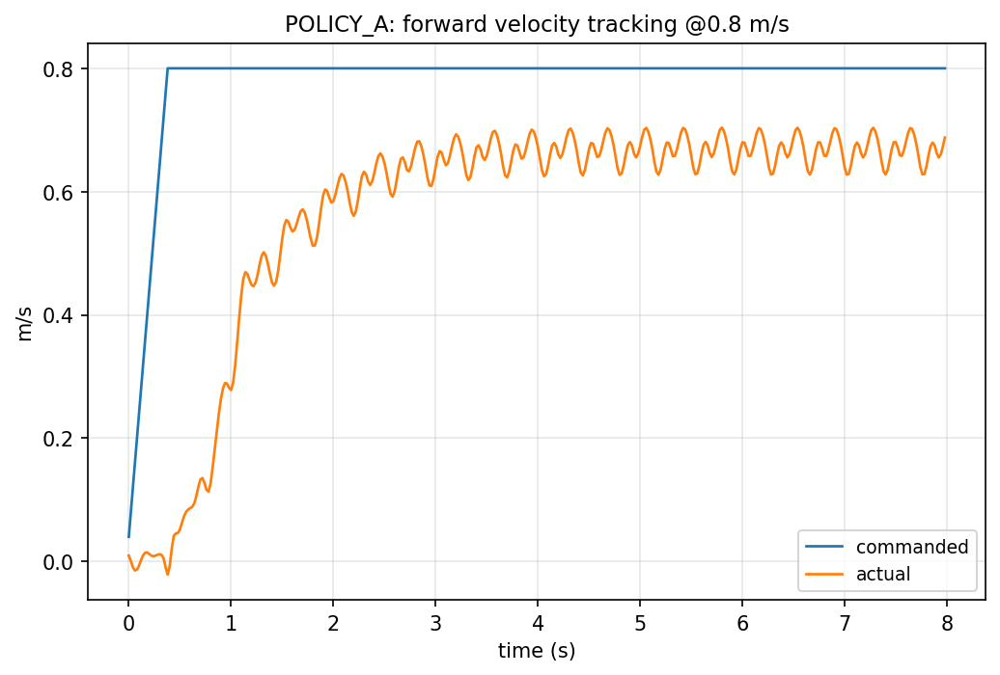
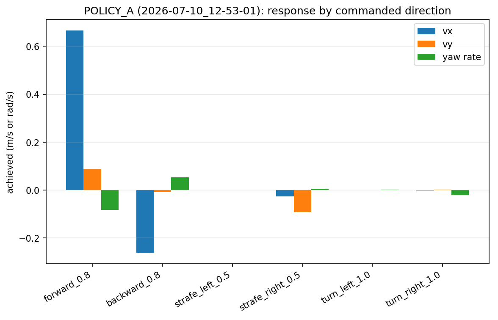
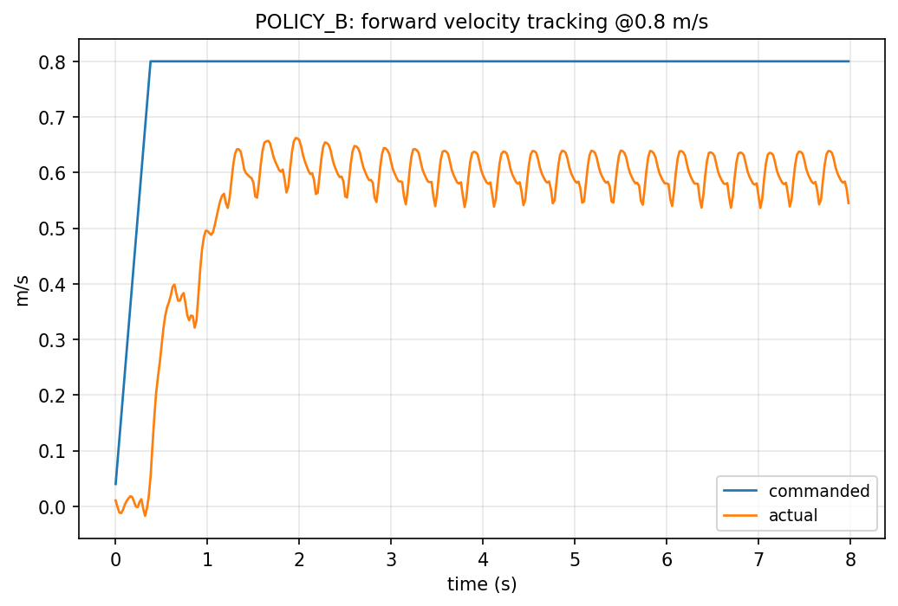
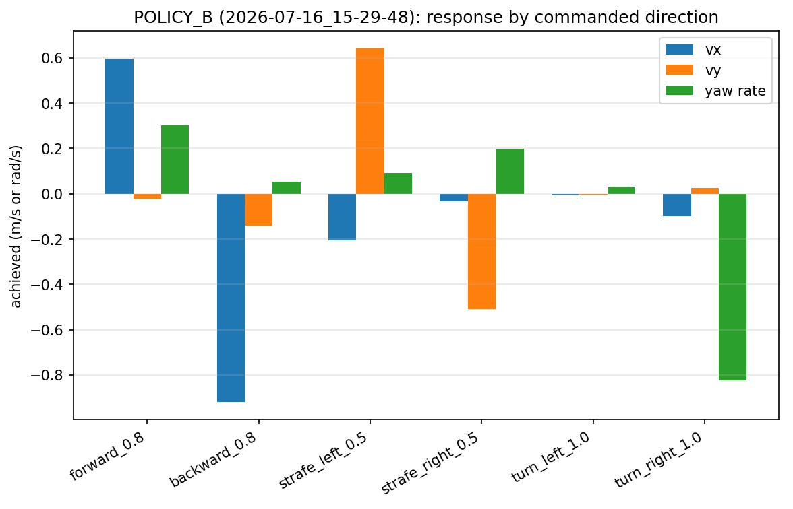
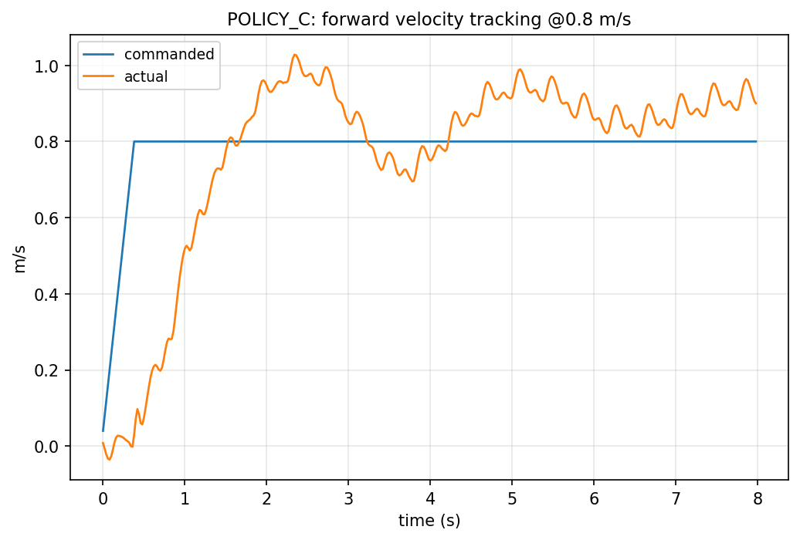
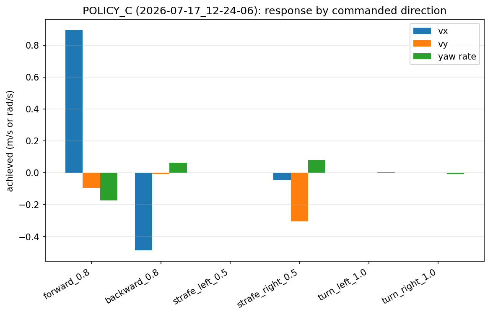
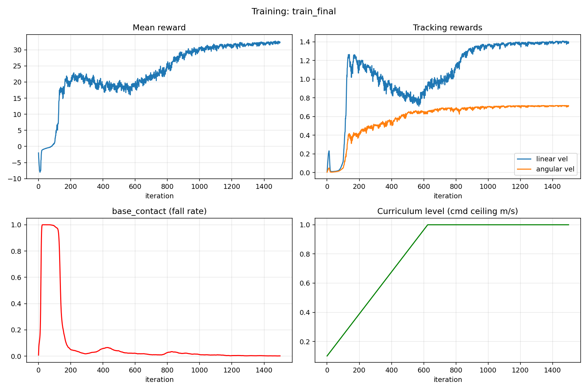
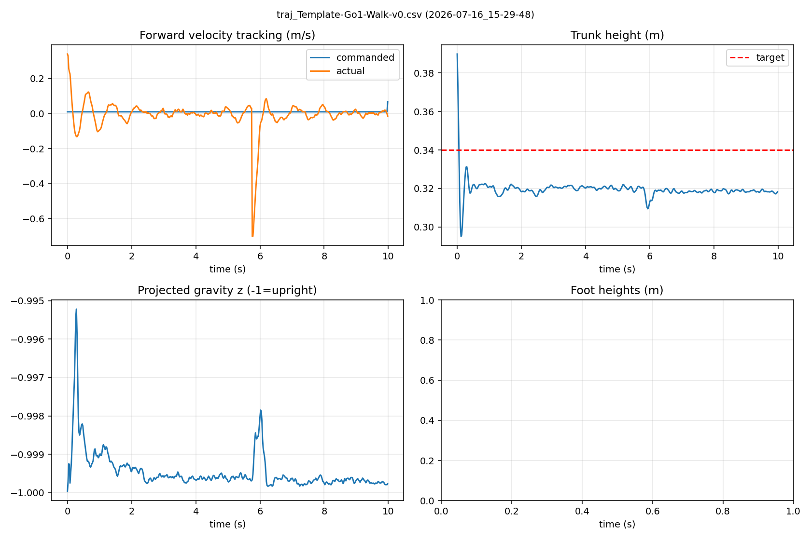
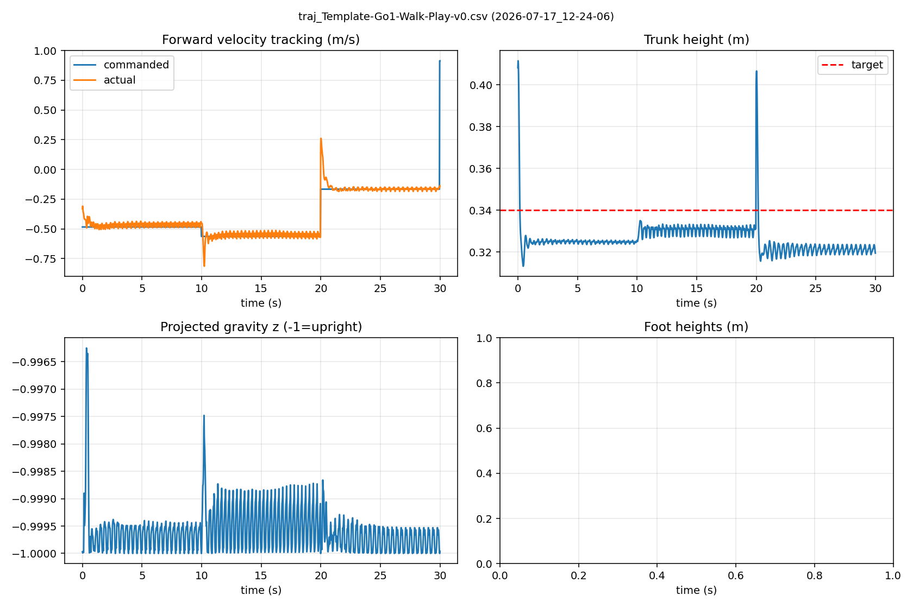

# Gallery: graphs, videos and photos

All files referenced here live under [`docs/results/`](results/). Images render inline once the
binary files have been pushed (see the top-level README).

## Policy comparison (MuJoCo, through the deployment code path)

| | Forward tracking @ 0.8 m/s | Response by commanded direction |
|---|---|---|
| **Policy A** (deployed) |  |  |
| **Policy B** |  |  |
| **Policy C** |  |  |

## Isaac Lab training curves

Each figure shows mean reward, linear/angular tracking rewards, fall rate (`base_contact`) and the
command-curriculum level for one training run. The figure title is the run's log name.



Other runs:
[`train_6dir`](results/plots/training_train_6dir.png) ·
[`train_alldir`](results/plots/training_train_alldir.png) ·
[`train_clearance_fix`](results/plots/training_train_clearance_fix.png) ·
[`train_enhanced`](results/plots/training_train_enhanced.png) ·
[`train_resume`](results/plots/training_train_resume.png) ·
[`train_stdfix`](results/plots/training_train_stdfix.png)

## Isaac Lab trajectory plots

Logged with `isaaclab/play_and_log.py`. Run names are the Isaac Lab log timestamps.

| Policy B run (2026-07-16_15-29-48) | Policy C run (2026-07-17_12-24-06) |
|---|---|
|  |  |

Earlier runs:
[07-07 17-13-20](results/plots/traj_2026-07-07_17-13-20_traj_Template-Go1-Walk-Play-v0.png) ·
[07-08 10-25-40](results/plots/traj_2026-07-08_10-25-40_traj_Template-Go1-Walk-Play-v0.png) ·
[07-08 13-29-45](results/plots/traj_2026-07-08_13-29-45_traj_Template-Go1-Walk-Play-v0.png) ·
[07-09 10-42-22](results/plots/traj_2026-07-09_10-42-22_traj_Template-Go1-Walk-Play-v0.png) ·
[07-09 11-39-56](results/plots/traj_2026-07-09_11-39-56_traj_Template-Go1-Walk-Play-v0.png) ·
[07-09 14-56-15](results/plots/traj_2026-07-09_14-56-15_traj_Template-Go1-Walk-Play-v0.png) ·
[07-09 16-32-50](results/plots/traj_2026-07-09_16-32-50_traj_Template-Go1-Walk-Play-v0.png) ·
[07-15 11-10-41](results/plots/traj_2026-07-15_11-10-41_traj_Template-Go1-Walk-Play-v0.png) ·
[07-16 12-12-56 (play)](results/plots/traj_2026-07-16_12-12-56_traj_Template-Go1-Walk-Play-v0.png) ·
[07-16 12-12-56](results/plots/traj_2026-07-16_12-12-56_traj_Template-Go1-Walk-v0.png)

Raw data for these plots: [`results/trajectories/`](results/trajectories/) (CSV).
Full training stdout: [`results/training_logs/`](results/training_logs/).

## Videos

GitHub plays `.mp4` files in its built-in viewer when you open the link.

| Video | Link |
|---|---|
| Isaac Lab playback, run 2026-07-17_12-24-06 (Policy C) | [isaaclab_2026-07-17_12-24-06.mp4](results/videos/isaaclab_2026-07-17_12-24-06.mp4) |
| MuJoCo, all directions, 30 s | [mujoco_all_directions_30s.mp4](results/videos/mujoco_all_directions_30s.mp4) |
| Cruise, slow motion | [cruise_slowmo.mp4](results/videos/cruise_slowmo.mp4) |
| Forward (slow) | [01_forward_slow.mp4](results/videos/01_forward_slow.mp4) |
| Forward (fast) | [02_forward_fast.mp4](results/videos/02_forward_fast.mp4) |
| Backward (slow) | [03_backward_slow.mp4](results/videos/03_backward_slow.mp4) |
| Backward (fast) | [04_backward_fast.mp4](results/videos/04_backward_fast.mp4) |
| Strafe left | [05_strafe_left.mp4](results/videos/05_strafe_left.mp4) |
| Strafe right | [06_strafe_right.mp4](results/videos/06_strafe_right.mp4) |
| Turn left | [07_turn_left.mp4](results/videos/07_turn_left.mp4) |
| Turn right | [08_turn_right.mp4](results/videos/08_turn_right.mp4) |
| Forward | [01_fwd.mp4](results/videos/01_fwd.mp4) |
| Back | [02_back.mp4](results/videos/02_back.mp4) |
| Strafe L | [03_strafeL.mp4](results/videos/03_strafeL.mp4) |
| Strafe R | [04_strafeR.mp4](results/videos/04_strafeR.mp4) |
| Turn L | [05_turnL.mp4](results/videos/05_turnL.mp4) |
| Turn R | [06_turnR.mp4](results/videos/06_turnR.mp4) |
| Forward fast | [07_fwd_fast.mp4](results/videos/07_fwd_fast.mp4) |
| Forward + turn | [08_fwd_turn.mp4](results/videos/08_fwd_turn.mp4) |

## Photos

Real-robot photos go in [`docs/photos/`](photos/). Embed them like this:

```markdown


```
